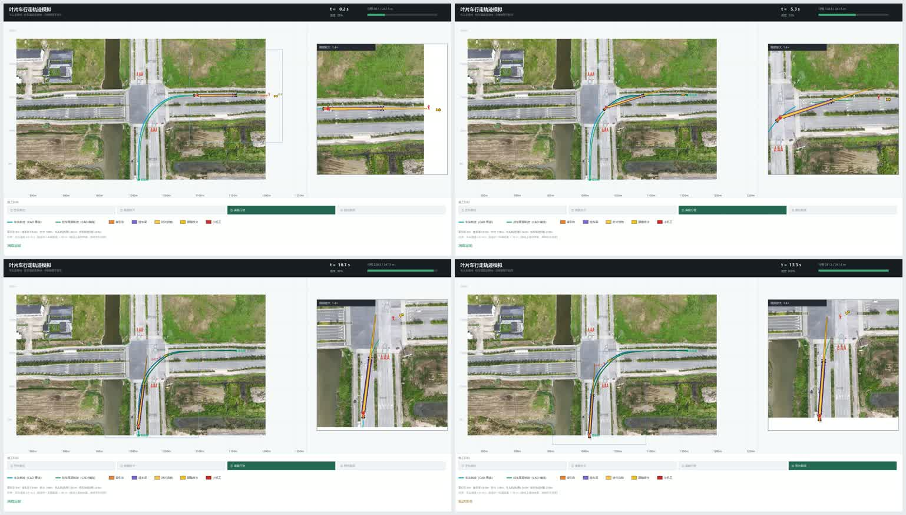

# 叶片车转弯行驶模拟（CAD → 视频）

从一张 CAD 图纸（DXF）自动生成「风机叶片运输车转弯行驶」的模拟视频，
**把轨迹与车辆直接叠在图纸里的航拍底图上**，输出横版（1920×1080）与竖版两个 MP4。



---

# 使用方法（5 个要点）

## ① 车辆行驶方向

图纸里的两条 SPLINE 是**有方向**的（从第一个点走到最后一个点），方向决定了车往哪边开、左转还是右转。
本工程当前为 **正向：由东向西 → 左转向南（画面 右上 → 左下）**。

| 说法 | 含义 |
|---|---|
| **正向（当前）** | 东→西 → **左转**向南（画面 右上 → 左下） |
| 反向 | 南→北 → **右转**向东（画面 左下 → 右上） |

**怎么改**（三种任选其一）：

```python
# 1) 改默认值（推荐，改一次即可）
#    文件 make_videos.py 第 17 行：
DEFAULT_REVERSE = False     # False=正向(东→西)  True=反向(南→北)
```

```bash
# 2) 临时切方向
python -X utf8 make_videos.py --reverse    # 强制反向
python -X utf8 make_videos.py --forward    # 强制正向
```

```
# 3) 在 CAD 里反转样条方向
#    AutoCAD 2018+ 命令 REVERSE ，依次点两条样条，重新导出 DXF
```

> 反向不需要改几何：只是把点序倒过来。**装货位、车尾起点、皮卡位置、起终点标注都会自动跟着变**。

---

## ② 车头走青色轨迹，车尾走绿色轨迹

这是整套模型的**唯一几何约定**：

| 对象 | 颜色 | ACI 色号 | 作用 |
|---|---|---|---|
| **牵引车（车头）** | **青色** | **ACI 4** | 车头中心沿这条线行驶，速度 `SPEED` m/s |
| **挂车尾部** | **绿色** | **ACI 3** | 车尾被牵引着沿这条线滑动，与挂接点保持 `COUPLE_L` 刚性距离 |

* 两条线都必须是 **SPLINE**（样条），程序用 `flattening()` 取曲线上的点。
* 车尾线**不是车头线偏移**出来的：58 m 长梁转弯时有明显"内轮差"，两条线必须分别画
  （本图纸：车头最小转弯半径 43.8 m、车尾 40.6 m，车尾转弯比车头早开始 40 m）。
* **颜色对调了怎么办**：改 `make_videos.py` 第 14 行 `CAB_ACI, TRL_ACI = '4', '3'` → `'3', '4'`。

---

## ③ CAD 图纸（DXF）应包含什么

程序会**自动识别**以下几类内容，缺了哪类就跳过哪类：

| 内容 | 图元类型 | 是否必需 | 用途 |
|---|---|---|---|
| 车头轨迹 | SPLINE，ACI **4**（青） | ✅ 必需 | 车辆行驶路径 |
| 车尾轨迹 | SPLINE，ACI **3**（绿） | ✅ 必需 | 挂车尾部路径 |
| **航拍图片** | **OLE2FRAME**（图片以 OLE 对象嵌入图纸） | 推荐 | 作为视频底图，轨迹直接压在路上 |
| 道路边线 / 圆角 | LINE / ARC / LWPOLYLINE | 可选 | 图纸还原 |
| 圆、多段线 | CIRCLE / LWPOLYLINE | 可选 | 如指挥手图标 |
| 文字标注 | MTEXT | 可选 | 如「翠竹路」「冬青路」「指挥手」 |

**关于图片（重点）**：

* DXF 标准**不保存** OLE 对象本体，但 AutoCAD 会把 EMF 预览以 `310` 二进制块写进 `OLE2FRAME`，
  本程序就是从这里把图片切出来的。
* 若 DXF 里没有 OLE 图、或切不出来：用 CAD 导出一张图存成 `photo.png` 放根目录即可，
  再用 `calibrate_from_shot.py` 标定位置。
* 图片与轨迹的**配准参数**存在 `photo_geo.json`，可重算：

```bash
# A) 像素级标定（推荐）：给一张 CAD 里能看见轨迹的截图，自动反解，实测误差 0.4 px
python -X utf8 calibrate_from_shot.py "参考/CAD截图.png"

# B) 粗配准：自动识别车道中心 + 指定比例
python -X utf8 georef_photo.py --scale 4.476
```

---

## ④ 皮卡距离车尾、小机工位置

两个跟随目标都沿**青色轨迹**行驶，位置由「挂车尾部」反推，不是按车头算：

```text
皮卡   位置 = 挂车尾部投影到青线的弧长 - ESCORT_GAP   （60 m）
小机工 位置 = 挂车尾部投影到青线的弧长 - WORKER_GAP    （50 m）
```

| 参数 | 位置 | 默认值 | 含义 |
|---|---|---|---|
| `ESCORT_GAP` | `leaf_common.py` | **60.0 m** | 黄色皮卡距**挂车尾部**的沿路距离 |
| `WORKER_GAP` | `leaf_common.py` | **50.0 m** | 红色小机工距挂车尾部的沿路距离 |
| `WORKER_H` | `leaf_common.py` | 4.0 m | 小机工图标高度（图纸里指挥手符号约 6.7 m，取折中） |
| `ESCORT_L` / `ESCORT_W` | `leaf_common.py` | 5.4 / 2.05 m | 皮卡外形尺寸 |

> 图层次序：车尾 → 叶片 → 小机工 → 皮卡（后画的在上层）。
> 叶片 108 m、梁 58 m → 叶片尖端超出梁尾约 **48 m**：
> 小机工 50 m、皮卡 60 m，**两者都在叶片尖端之外**，相互相距 10 m。
> 距离为固定沿路距离，全程保持（末段因青线结束略短）。

## ⑤ 挂车梁长度、货物叶片长度

| 参数 | 位置 | 默认值 | 含义 |
|---|---|---|---|
| `COUPLE_L` | `leaf_common.py` 第 31 行 | **58.0 m** | 挂车梁长：挂接点→车尾的**刚性距离** |
| `BLADE_L` | `leaf_common.py` 第 26 行 | **108.0 m** | 叶片货物长度 |
| `BLADE_ROOT` / `BLADE_TIP` | `leaf_common.py` | 2.8 / 0.9 m | 叶片根部 / 尖端宽度 |
| `CAB_L` / `CAB_W` | `leaf_common.py` | 8.0 / 2.6 m | 牵引车长 / 宽 |
| `TRL_W` | `leaf_common.py` | 3.6 m | 挂车梁宽度 |

**改梁长要注意**：装货位（车头起步位置）会自动重算 ——
程序遍历车头位置，找「挂接点→绿线起点 = `COUPLE_L`」的那一点。
所以梁长从 50 改成 58，装货位会自动从青线 21.5% 挪到 24.8%，**不需要手改**。

视频底部信息行显示的「挂车梁 58.0m」取自 `COUPLE_L` 常量（刚性定值），
**不会随逐帧求解值跳动**（求解值只在 `_final_check.py` 里用于校核，实测 57.9~59.0 m）。

---

# 快速开始

```bash
# 全流程：提取轨迹 → 提取图元 → 提取底图 → 验收 → 渲染横版/竖版
python -X utf8 make_videos.py

# 只提取 + 验收（约 30 秒，调参时用）
python -X utf8 make_videos.py --no-render

# 换一张图纸
python -X utf8 make_videos.py --dxf "其他图纸.dxf"
```

Windows 下也可以直接**双击 `一键生成视频.bat`**。

产物（**文件名自动取自 DXF 名**）：

```
转翠竹路_横版.mp4   1920×1080   ← 由 转翠竹路.dxf 生成
转翠竹路.mp4        竖版（画布随图纸自动）
```

换图纸即自动跟随，例如 `--dxf "图纸A.dxf"` → `图纸A.mp4` / `图纸A_横版.mp4`
（名字记录在 `_traj.json` 的 `src` 字段，两个渲染器据此命名）。

---

# 目录结构

```
叶片车转弯模拟/
├─ 转翠竹路.dxf            # 源图纸（含航拍底图 OLE）
├─ 一键生成视频.bat         # 双击运行
├─ make_videos.py          # 一键流水线（6 步）+ 方向开关
├─ leaf_common.py          # 核心：参数 / 物理模型 / 绘图 / 底图贴图
├─ extract_cad_traj.py     # ① 提取两条轨迹（支持 --reverse）
├─ extract_drawing.py      # ② 提取其它图元
├─ extract_ole_image.py    # ③ 从 OLE2FRAME 切出 EMF
├─ make_photo.py           # ③ EMF → photo.png
├─ georef_photo.py         # 底图粗配准
├─ calibrate_from_shot.py  # 底图像素级标定（推荐）
├─ leaf_truck_wide.py      # ④ 渲染横版
├─ leaf_truck_sim.py       # ⑤ 渲染竖版
├─ _final_check.py         # 物理模型验收
├─ preview_drawing.py      # 工具：图纸元素还原核对图
├─ preview_traj.py         # 工具：轨迹 vs 样条控制点核对图
├─ photo_geo.json          # 底图配准参数（已标定好）
├─ skill/                  # DSH skill 本体（见下）
└─ 参考/
   ├─ CAD截图.png          # 用于像素级标定的参考截图
   ├─ 方向对比.png          # 正向 / 反向 对比
   └─ 成品预览.jpg
```

## `skill/`：让 AI 按这套流程出片

`skill/` 内含 `SKILL.md` + `scripts/{preflight_dxf.py, set_params.py}`，是可**整体安装**的 skill：

```powershell
Copy-Item -Recurse -Force "<本仓库>\skill\*" "$env:USERPROFILE\.dsh\skills\blade-truck-sim\"
```

安装后在 DSH 里说「生成叶片车模拟视频」，它会先**问 6 项**（图纸路径 / 梁长 / 叶片长 / 小机工距离 /
皮卡距离 / 起始方向）、跑 `preflight_dxf.py` 预检、用 `set_params.py` 写参、验收合格再出片；
并按本 README 的规则判定底图（有 OLE 贴航拍图，没有则以 CAD 图纸为准）。

> `skill/scripts/` 与仓库根目录的 `preflight_dxf.py`、`set_params.py` 是**两份镜像**
> （第 0、5 节的命令在项目目录里跑根目录那份），改了脚本记得两边同步。


---

# 环境要求

* Python **3.8+**
* 依赖：`pip install -r requirements.txt`（ezdxf / numpy / Pillow）
* **ffmpeg**（合成视频用）。程序会自动在以下位置查找：
  1. 环境变量 `FFMPEG`
  2. 系统 `PATH`
  3. WinGet 安装的 ffmpeg（`%LOCALAPPDATA%\Microsoft\WinGet\Packages\Gyan.FFmpeg*`）
  4. `C:\ffmpeg\bin\ffmpeg.exe`

  都没有就先装：`winget install Gyan.FFmpeg`。

> 注：EMF→PNG 用到 Windows 自带的 GDI+（通过 PowerShell），**仅 Windows 可用**。
> 若在 Linux/macOS 跑，先自行导出 `photo.png` 放到根目录即可。

---

# 参数总表

### 车辆与货物（`leaf_common.py`）

| 参数 | 默认 | 含义 |
|---|---|---|
| `COUPLE_L` | 58.0 | 挂车梁长 m（刚性：挂接点→车尾） |
| `BLADE_L` | 108.0 | 叶片货物长度 m |
| `BLADE_ROOT` / `BLADE_TIP` | 2.8 / 0.9 | 叶片根部 / 尖端宽度 m |
| `CAB_L` / `CAB_W` | 8.0 / 2.6 | 牵引车长 / 宽 m |
| `TRL_W` | 3.6 | 挂车梁宽度 m |
| `HITCH_OFF` | 1.2 | 挂接点相对车尾的偏移 m |
| `SPEED` | 4.0 | 车头沿青线速度 m/s |

### 跟随目标（皮卡 / 小机工）

| 参数 | 默认 | 含义 |
|---|---|---|
| `ESCORT_GAP` | **60.0** | 黄色皮卡距**挂车尾部**的沿路距离 m |
| `WORKER_GAP` | **50.0** | 红色小机工距挂车尾部的沿路距离 m |
| `WORKER_H` | 4.0 | 小机工图标高度 m |
| `ESCORT_L` / `ESCORT_W` | 5.4 / 2.05 | 皮卡外形尺寸 m |

### 时间轴与片头

| 参数 | 默认 | 含义 |
|---|---|---|
| `FPS` / `DUR` | 30 / 16 | 帧率 / 素材总时长 s（共 480 帧） |
| `P1, P2, P3` | 0, 0.16, 0.96 | 四阶段分割点：①就位 ②装载 ③行驶 ④到达 |
| 片头裁剪 | 自动 | 从 `P2` 开始渲染（剪掉就位+装载，成片 13.43 s） |

### 行驶方向

| 参数 | 默认 | 含义 |
|---|---|---|
| `DEFAULT_REVERSE`（`make_videos.py`） | **False** | False=正向（东→西，左转向南）；True=反向（南→北，右转向东） |
| `--reverse` / `--forward` | — | 命令行临时覆盖 |

### 底图配准（`photo_geo.json`）

| 字段 | 默认 | 含义 |
|---|---|---|
| `x0` | 831.52 | 照片**西**边缘在图纸坐标（m） |
| `y0` | -21.88 | 照片**南**边缘在图纸坐标（m） |
| `w` / `h` | 376.26 / 211.81 | 照片覆盖的宽度 / 高度 m |
| `scale_px_per_m` | 4.476 | 照片像素 / 米 |

### 版式（`leaf_truck_wide.py` 顶部）

横版有三块：主图（`MX0/MY0/MW/MH`）、局部放大窗（`IX0/IY0/ISZ`）、底部信息条（`BX0/BY0/BW/BH`）。
**原先右侧的车挂夹角/指标数据面板已移除**（`GX0/GY0/GW/GH` 保留为 0 占位）。
有底图时主图与放大窗按内容宽高比自动排版并居中；无底图时用旧布局（`if L.HAS_PHOTO` 二选一）。

### 颜色与文字（`leaf_common.py`）

`C_CAB` / `C_TRL` / `C_BLADE` / `C_ESC` / `C_ROAD` / `C_ROAD_TXT` 等；
`PHASES` 定义四个阶段的名称。

---

# 工作原理（简述）

1. **轨迹**：DXF 的 SPLINE 是 B 样条，控制点**不在曲线上**。必须用 `spline.flattening(0.02)` 取曲线上的点，
   再按弧长等距重采样（0.4 m），否则曲线会外凸成波浪（实测偏差可达 9 m）。
2. **装货位**：遍历车头位置，取「挂接点→绿线起点」最接近梁长的点（自动，换图纸免调）。
3. **车尾牵引**：装货位之前车尾冻结在绿线起点；之后每帧在 ±120 个绿线段内找 `|挂接点-车尾| = 梁长` 的交点，
   取"前方最近"的解，限幅 4 点/帧，保证连续且单调。
4. **坐标系**：渲染器 `screen_y = +world_y`（y 向下），而 CAD 的 +y 是北，因此 `MIRROR_Y = True`
   把世界 y 取反，两者相抵后画面与 CAD 同朝向（北在上、左转仍是左转）。
5. **底图**：DXF 不保存 OLE 本体，但 AutoCAD 会把 EMF 预览以 `310` 二进制块写进 `OLE2FRAME`，
   可原样切出渲染。底图与轨迹共用同一套坐标变换，所以能精确贴合。

---

# 当前工程实测数据

| 指标 | 数值 |
|---|---|
| 图纸 | `转翠竹路.dxf` |
| 车头轨迹（青 ACI 4） | 605 点，241.5 m |
| 尾部轨迹（绿 ACI 3） | 596 点，237.8 m |
| 行驶方向 | 正向：东→西，左转向南 |
| 挂车梁长 | 57.9 ~ 59.0 m（目标 58），偏离 >5 m 的帧 0/403 |
| 车尾行程 | 0 → 177.1 / 237.8 m，单调 |
| 车挂夹角峰值 | 28.1°（仅内部校核，画面不再显示） |
| 皮卡距尾部 | 56.5 ~ 60.0 m（青线终点处略短） |
| 装货位 | 青线 24.83%（误差 0.14 m） |
| 底图配准 | 4.476 px/m，像素级标定偏差 0.40 px |

---

# 常见问题

| 现象 | 原因 / 处理 |
|---|---|
| 轨迹有波浪、不贴 CAD | 用了控制点插值 → 必须 `flattening()` |
| 转向与 CAD 相反 | 行驶方向问题 → 用 `--reverse` / `--forward`，或 `DEFAULT_REVERSE` |
| 画面上下颠倒 | `MIRROR_Y` 必须为 `True` |
| 照片太大/太小 | 底图比例不对 → `calibrate_from_shot.py` 标定 |
| 轨迹没压在道路上 | 调 `photo_geo.json` 的 `x0/y0`，或重新标定 |
| 梁长被拉长 | 求解器跟不上 → 加大 `window` / `max_step`（`solve_tail_positions`） |
| 底图没出来 | 图纸无 OLE 预览，或 PowerShell 不可用；自行导出 `photo.png` |
| 中文乱码 | Windows 控制台 → 命令加 `-X utf8` |

---

# 数据说明

`转翠竹路.dxf` 为真实工程图纸（含航拍底图），仅用于演示本工具的处理流程。
换用其他图纸时请确认：车头轨迹为 **ACI 4（青）** SPLINE、车尾轨迹为 **ACI 3（绿）** SPLINE；
颜色对调时把 `make_videos.py` 里的 `CAB_ACI, TRL_ACI` 改成 `'3', '4'`。
